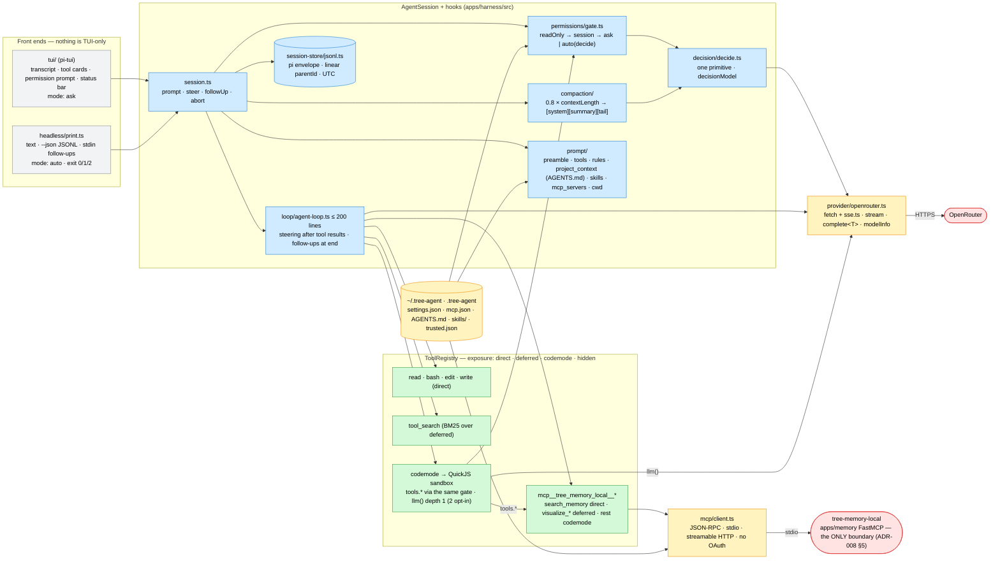

# ADR-016: tree-agent — A Light pi Clone on Node + pnpm, Raw-Fetch OpenRouter, a Hand-Rolled MCP Client with Exposure Levels, Two Permission Modes, One Decision Primitive, Ratio Compaction and Linear JSONL Sessions

- **Status:** Accepted
- **Date:** 2026-10-24
- **Deciders:** Paul (project owner)
- **Context references:**
  - `tasks/202-harness-toolchain-node-pnpm-vitest-biome.md` … `tasks/213-harness-docs-readmes-and-stack-note.md` (this feature's task plan, `feature: tree-agent-harness`)
  - `docs/notes/tree-agent-harness-spec.md` (the settled spec, §0–§19; this ADR records the design choices and how they fit, the spec is the contract) and `docs/notes/modern-typescript-stack.md` (the Bun argument this ADR departs from)
  - ADR-008 §5 ("MCP is the only harness↔memory interface"; the harness must never import pipeline code) — relied on, confirmed, unchanged
  - `docs/glossary.md` — **tree-agent**, **Exposure**, **Tool activation**, **Codemode script**, **Decision model**, **Permission mode**, **Steering message**, **Follow-up message**, **Compaction**, **Session entry**, **Context file** (added in this feature's grooming commit)
  - `.tree-agent/mcp.json` (committed in task 209), `.mcp.json` (Claude Code's, untouched), `apps/harness/{package.json,Makefile,biome.json}`, `.github/workflows/ci.yml` (harness job), `.pre-commit-config.yaml` (`biome-check-harness`), `AGENTS.md` (line 37, line 55, Verification cadence)
  - Reference implementations the spec names: pi `@bdb1517` (loop, exposure, MCP, codemode, sessions, compaction), Claude Code `@3a85455` (the `auto` classifier only), OpenClaw `@a6ce7b0` (risk enforced at runtime)
  - Verified 2026-10-24: `@earendil-works/pi-tui@1.4.0`, `quickjs-emscripten@0.32.0`, `zod@3.25.76`, `zod-to-json-schema@3.25.2` install and import on Node 26 / npm; OpenRouter `GET /api/v1/models` lists `anthropic/claude-sonnet-5.5` and `anthropic/claude-haiku-5.5` (1 M context, 128 k output, `structured_outputs`); local Node v26.7.0, corepack 0.25.2, no global pnpm; `apps/memory/src/tree/mcp/*.py` sets no tool `annotations` (no `readOnlyHint`)

## Context

`apps/harness` is a bare Bun scaffold (commit 7a10a80 stripped the previous Ink harness). Chapter 6 of the
book needs a harness whose every concern is one readable module, and the spec of 2026-10-24 settles what it
is: **tree-agent**, a light pi clone — one process, one agent loop under ~200 lines, one `AgentSession` that
both the TUI and the headless CLI drive, every product concern (permissions, compaction, prompt assembly,
tool search, MCP, skills) attached through a hook, never inside the loop. The spec's content is closed; what
this ADR decides is how the spec lands in THIS repo and which of its choices are architectural enough to be
recorded next to the memory app's ADRs.

Constraints: ADR-008 §5 makes MCP the only boundary between harness and memory — the harness is a client of
`tree-memory`, never an importer of `tree.*`; the repo already runs a Python toolchain (uv/ruff/pytest) and a
JS one (Bun/Biome) with Make, CI and pre-commit wired for both; the book's listings are ≤ 76 characters per
line; `docs/notes/modern-typescript-stack.md` argues for Bun on small projects; the hosted memory server sits
behind Horizon OAuth and the spec puts MCP OAuth out of scope; the repo's `.mcp.json` is Claude Code's
configuration (three servers, Claude Code's `type`/`${VAR}` conventions); the memory server's tools declare no
`readOnlyHint`; the spec's tool names must match `^[a-z][a-z0-9_]*$` while the chosen server key is
`tree-memory-local`.

## Decision

Twelve related choices, one design:

1. **Toolchain: Node ≥ 22, ESM, TS `strict`, `pnpm` (via corepack), `vitest`, Biome — Bun is retired.**
   The spec's stack is pi's minus the monorepo, and the chapter's listings, commands and tests must match what
   a reader of pi sees; a Bun-flavoured port would teach a second dialect (`bun:test`, `Bun.file`,
   `bun build --compile`) the book never uses. The repo accepts the churn of moving the Makefile, the CI job,
   the pre-commit hook, AGENTS.md and `.gitignore` once (task 202) — two JS toolchains in history, one in
   the tree. *Why not keep Bun:* `docs/notes/modern-typescript-stack.md` is right for a greenfield tool; this
   is a teaching clone of a Node project, and fidelity wins. *Why pnpm over npm:* pi's lockfile and scripts
   are pnpm's; corepack makes it a zero-install choice. *Upgrade trigger:* none foreseen; a Bun port is a
   reader exercise, not a repo goal.
2. **Provider: raw `fetch` + a hand-written SSE parser against OpenRouter's chat-completions wire; no SDK.**
   The wire (keep-alive comments, the trailing usage chunk, mid-stream `error` chunks, tool-call deltas
   reassembled by `index`, `response_format.json_schema` + `require_parameters`) is taught content; an SDK
   would hide it. `fetch` is injectable so the contract is pinned offline; two live tests skip without
   `OPENROUTER_API_KEY` and CI never sets it. Defaults `anthropic/claude-sonnet-5.5` (main) and
   `anthropic/claude-haiku-5.5` (decision + sandbox `llm()`), verified against `/api/v1/models`.
3. **MCP: a hand-rolled JSON-RPC client (stdio + streamable HTTP, `initialize`/`tools/list`/`tools/call`
   only) and `.tree-agent/mcp.json` as the ONLY MCP source.** ~300 lines, no SDK, same stance as `pi-mcp`;
   the HTTP transport reuses the provider's SSE parser; OAuth, the legacy SSE transport, resources and
   prompts are out. The repo commits `.tree-agent/mcp.json` with `tree-memory-local` only (stdio, the same
   `uv … serve_mcp.py` command as `.mcp.json`), exposure `search_memory: direct`, `visualize_*: deferred`,
   the rest `codemode`; server names are sanitised to the tool-name regex at registration
   (`mcp__tree_memory_local__<tool>`) so every tool is a valid script property. *Why `.mcp.json` is not
   parsed:* it is Claude Code's file — a different schema (`type`, `${VAR}` expansion, a `mongodb-mcp-server`
   the harness has no business spawning) owned by a different client; one file per client keeps both honest,
   and the hosted `tree-memory` entry in it is unreachable without OAuth anyway. The hosted server is
   documented as a `~/.tree-agent/mcp.json` entry with an `Authorization` header once a token exists.
4. **Exposure levels `direct · deferred · codemode · hidden`, MCP default `codemode`, `tool_search` (BM25,
   no dependency) for `deferred`.** With no MCP servers the model sees exactly 4 tools; every MCP tool costs
   zero prompt lines unless an operator promotes it by glob. Skills follow the same progressive-disclosure
   rule: name + description + path in the prompt, the body on `read`. *Why not `direct` by default for a
   small server:* the default must hold for a 60-tool server too; promotion is one glob.
5. **Permissions: two modes, `ask` and `auto`, with a read-only exemption; TUI defaults to `ask`, headless
   to `auto`; a headless prompt is a deny → exit 2.** First-match gate: `isReadOnly` (`read`, `tool_search`,
   MCP `readOnlyHint`) → allow; session-allowed → allow; `ask` → prompt; `auto` → classifier, prompt only on
   `dangerous: true` or failure (fail-closed). No rule files, no bypass, nothing persisted but the mode. A
   codemode script's `tools.x()` takes the same gate (`origin: "codemode"`), so there is one permission path.
   Consequence recorded: the memory server's tools carry no `readOnlyHint`, so `search_memory` is classified
   in `auto` and prompted once in `ask` — annotating them is a separate memory-app task, not this feature's.
   *Why headless `auto`:* `ask` without a prompter would stop on the first write; `auto` lets safe calls run
   and still fails CI loudly on a dangerous one (exit 2, `--on-blocked continue` to opt out).
6. **One decision-model primitive, `decide<T>()`.** `provider.complete` on `settings.decisionModel` with a
   timeout, one parse retry and an optional cache; consumers are the `auto` classifier and the compaction
   summariser; the primitive knows neither. *Why not a classifier class per use:* ToC 5.3 teaches the
   primitive; the consumers are 20-line callers.
7. **Compaction: `triggerRatio` (0.8) × the CURRENT model's `contextLength`, always, to
   `[system][summary][tail]`.** Cut at a `user` boundary keeping ≈ 20 k tokens; a structured summary on the
   decision model, merged with any previous one; one overflow retry; a breaker after 3 failures. The ratio is
   the only trigger (no decision-model trigger — discussed in the chapter, not built). *Why `chars / 4`
   corrected by the last `usage`:* good enough for an 80 % trigger; a tokenizer dependency buys nothing here.
8. **Sessions: pi's JSONL envelope (`id`, `parentId`, `timestamp`, `type`), written linearly.** One file per
   session under `~/.tree-agent/sessions/--<cwd-slug>--/`, `appendFileSync` per finalized event, `parentId`
   always the previous entry; `/tree`, forks and branch summaries are non-goals. pi-compatible on disk, a
   fraction of pi's session manager in code. Timestamps are ISO 8601 UTC (AGENTS.md: dates are tz-aware).
9. **Codemode: `quickjs-emscripten` per call, a hand-written bridge, `llm()` depth 1 by default.** Host
   functions are promise-based (a QuickJS promise resolved from the host, `executePendingJobs` pumped on
   settle) so `Promise.all` fans out under a `concurrency` = 4 semaphore — Asyncify would suspend the whole VM
   and serialise the fan-out. `llm()` at depth 1 is a plain completion (the RLM paper's setting, linear
   cost, one gate); depth 2 (`codemode.llm.depth: 2`) reuses `runLoop` with the same hooks and the registry
   minus `codemode`; depth N is explained, not built.
10. **Biome `lineWidth` 76 for `src/**`, 100 for `tests/**`.** The book lists `src/` and must fit 76 columns
    (55 with an annotation — the author's job at listing time); tests are not listed and read better at 100.
    One `biome.json` with an override, not two configs.
11. **Harness verification cadence.** After every harness commit: `make harness-lint-fix && make
    harness-lint-check && make harness-typecheck && make harness-tests && make pre-commit`; harness e2e is a
    headless `tree-agent "<prompt>"` against `tree-memory-local` with a live key, recorded as a `[HUMAN]` AC.
    `make harness-tests` over a bare `pnpm vitest` because the Makefile exports `.env`: without it the live
    provider tests silently skip and a broken provider looks green (the mirror of the memory rule, where the
    bare command fails instead). `squid-testing-python` applies to Python only.
12. **ADR-008 §5 holds: MCP is the only harness↔memory boundary.** Nothing under `apps/harness/src` imports
    `apps/memory`; the harness reaches memory through `tree-memory-local`'s tools (`direct`, `deferred` or
    from a codemode script) and through nothing else; a grep AC in task 204 pins it. The Session-end hook
    (ADR-008 §5) stays a Claude Code hook — tree-agent sessions are not ingested into memory (a future
    `ingest_conversation` call from the harness would be one more MCP call, not an import).

Non-goals (recorded, not built — spec §2): subagents, plan mode, session tree navigation, an extensions API,
prompt templates, channels, auto-memory, parallel tool execution, MCP OAuth/resources/prompts, a model
catalog beyond OpenRouter, permission rule files, clarification and compaction decision models, themes.

Bias-to-least notes: a toolchain copied from the reference over a faster one; `fetch` over an SDK; ~300 lines
of JSON-RPC over the MCP SDK; a glob map over a per-tool UI; two modes over a policy language; one `decide`
over N classifiers; a ratio over a learned trigger; a flat JSONL over a session tree; a semaphore over a
scheduler; one Biome override over two configs.

## Diagram

## Consequences

- **The repo speaks pi's dialect.** Readers move between pi, the chapter and `apps/harness` without
  translation; the cost is a one-time rewiring of Make/CI/pre-commit and a second package manager on the
  machine (`corepack enable pnpm`, no global install). The Bun stack note stays as general advice with a
  pointer to this ADR.
- **The wire is visible, and testable offline.** Every OpenRouter and MCP frame the chapter discusses has a
  fixture-backed test; the two live tests cost one key and skip without it — which is why `make harness-tests`
  (exports `.env`) is the cadence command and CI deliberately has no key.
- **Four tools by default, memory one line away.** The committed `.tree-agent/mcp.json` adds exactly one
  prompt line (`search_memory`), two discoverable tools and a script-only remainder; a reader sees all four
  exposure levels on one real server. `search_memory` is prompted/classified until the memory app annotates
  its tools (recorded follow-up).
- **One permission path.** Model calls and script calls share one gate; headless failure is loud (exit 2).
  The trade: `auto` costs one decision-model call per non-read-only, non-cached call (~haiku prices).
- **Sessions are files, flat.** Any session can be read with `jq` and resumed; branching is not supported
  and a branching file is read along one ancestry only.
- **Compaction is predictable and dumb.** A fixed ratio never surprises; a summary on a small model can lose
  detail — `criticalContext` keeps paths, names and errors verbatim, and `/compact <instructions>` lets the
  user steer it.
- **The boundary holds.** The harness gained a lot of code and still imports nothing from `apps/memory`;
  a future "persist tree-agent sessions into memory" is one `ingest_conversation` tool call away.
- **What would justify upgrading.** A second provider → a provider interface with a second implementation
  (not before); a second MCP client need (resources, OAuth) → revisit the SDK; a measured prompt-cache cost
  from activations → a stable `tools` array; a 60-tool server where BM25 misranks → a semantic
  `tool_search`; a measured case where the 80 % ratio is wrong for a model → the decision-model trigger from
  ToC 5.5.2; a reader's need for forks → pi's session tree.
