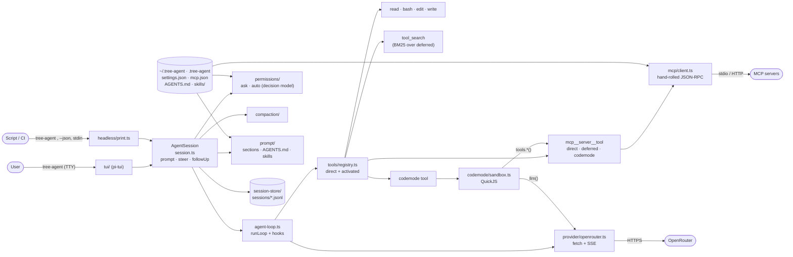
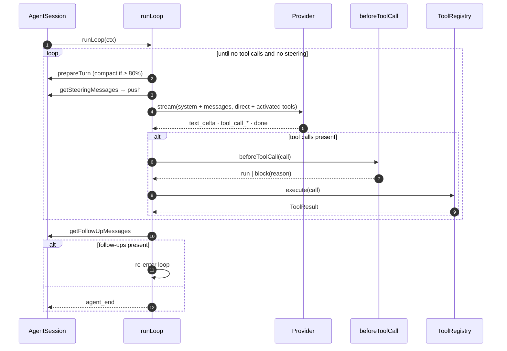
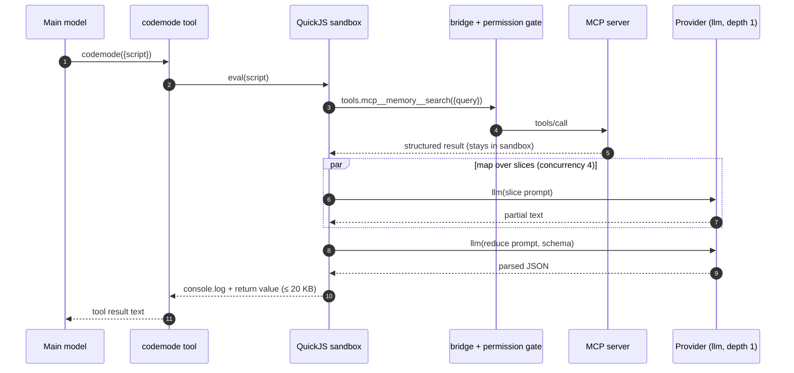
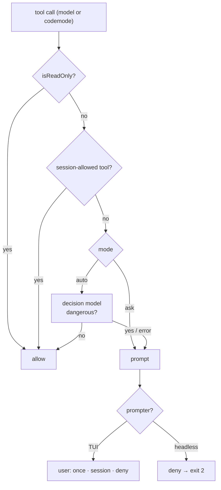
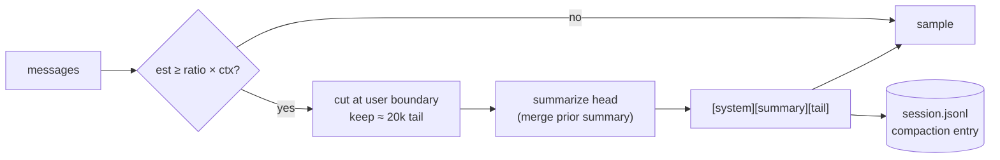

# Tree-Agent Harness Implementation Spec

> `tree-agent`: a light [pi](https://github.com/earendil-works/pi/tree/bdb151774ed6bef2b5676bbff4669f20a0c233fe) clone in TypeScript for Chapter 6 of *Building a Personal Assistant (From Scratch)*. Target reader: the software factory that implements it. Self-contained. Supersedes the "Pi-Lite" draft of the same day.

## 0. Purpose

One process, one agent loop, one `AgentSession` that both the TUI and the headless CLI drive. Every product concern (permissions, compaction, prompt assembly, tool search, MCP, skills) attaches to the loop through a hook, never inside it. Teaching value comes from the loop staying under ~200 lines and each concern being one readable module.

Guiding principle, from pi: **minimal core, everything else in files the user owns**. When this spec is silent, do what pi `@bdb1517` does. Claude Code `@3a85455` is the reference for the `auto` permission mode only; OpenClaw `@a6ce7b0` for "risk is enforced at runtime, not in prompt prose".

## 1. Decisions (confirmed 2026-10-24 unless marked *open*)

| Decision | Choice | Why |
|---|---|---|
| Name / binary | `tree-agent` | `tree-agent` alone opens the TUI; `tree-agent <prompt>` runs headless (§15). Chosen over `tree` to avoid shadowing the Unix `tree` command. |
| Repo location | `iusztinpaul/building-agentic-systems` → `chapter-6/tree-agent/` | Series code repo (`series.yaml`). |
| Runtime | Node ≥ 22, ESM, TS `strict`, `pnpm`, `vitest`, `biome` | pi's stack minus the monorepo. |
| Package layout | Single package, `src/` subfolders per module | Monorepo adds nothing at this size. |
| Provider transport | Raw `fetch` + hand-written SSE parser | Our analogue of `pi-ai`; the OpenRouter wire is taught content, an SDK would hide it. |
| Schema lib | `zod` + `zod-to-json-schema` | Tool params and config validated once, exported as JSON Schema. |
| TUI | `@earendil-works/pi-tui` (npm 1.4.0), imported | Same as pi. Rendering is not the lesson; the TUI module is ~6 components over `AgentEvent`s. |
| Sandbox | `quickjs-emscripten` (npm 0.32.0), WASM | Same engine as `pi-codemode`. The bridge (`tools.*` → registry → permission gate) is hand-written because it *is* the lesson. |
| MCP client | Hand-rolled: stdio + streamable HTTP, JSON-RPC 2.0, `initialize` / `tools/list` / `tools/call` only | Same stance as `pi-mcp` (no official SDK). ~300 lines; OAuth and SSE transport out of scope. |
| Session persistence | Append-only JSONL, pi's entry envelope (`id`, `parentId`, `timestamp`, `type`), written **linearly** | pi-compatible file shape; `/tree` navigation, forks and branch summaries stay non-goals. |
| Tool exposure | `direct · deferred · codemode · hidden`; MCP default `codemode`; `tool_search` for `deferred` | pi's full exposure model (§8, §10). |
| Permissions | Two modes only: `ask` (prompt on every non-read-only call) and `auto` (decision model flags dangerous calls, prompt only on those). TUI defaults to `ask`, headless to `auto` | User decision. No rule files, no bypass. Headless in `ask` mode would exit on the first write. |
| Read-only exemption | `read`, `tool_search`, MCP tools with `readOnlyHint` never prompt, in both modes | "Ask for all commands" read literally would prompt on every `read`. Confirmed. |
| Compaction trigger | `triggerRatio` (default 0.8) × `contextLength` of the **current** model, always; configurable via settings and `--compact-at` | User decision. No decision-model trigger. |
| Tool execution | Sequential, in call order | Parallel batches are an optimization, not a concept. |
| Token counting | `chars / 4`, corrected by the ratio from the last `usage.prompt_tokens` | Good enough for an 80% trigger. |
| Default models | main `anthropic/claude-sonnet-5.5`, decision + sandbox `llm()` default `anthropic/claude-haiku-5.5` | Verify IDs against `GET /api/v1/models` at build time. |
| Config dirs | `~/.tree-agent/` (user), `.tree-agent/` (project) | Mirrors `~/.pi/agent/` + `.pi/`. |
| Book code style | ≤ 76 chars/line (≤ 55 when a line carries an annotation); listings > 4 lines are introduced in prose | `requirements/code-formatting-rules.md`. Snippets here are sketches; the factory formats real code to the rule. |

## 2. Scope

### In scope

1. Single agent loop, no subagents, OpenRouter streaming, steering + follow-up queues.
2. Agent Skills standard (`SKILL.md`), progressive disclosure.
3. MCP client with all four exposures; `tool_search` for `deferred`; `codemode` sandbox exposing `llm()` so a script can orchestrate recursive model calls (RLM).
4. Permission layer: `ask` | `auto`, the latter backed by a decision model.
5. TUI (`tree-agent`) and headless CLI (`tree-agent <prompt>`, `--json`, stdin).
6. Memory: `AGENTS.md` discovery and injection.
7. Compaction by summarization: `[system prompt][summary][tail]` at 80% of the context window.

### Non-goals

Subagents, plan mode, session tree navigation / forking / branch summaries, extensions API, prompt templates, Telegram or any channel, auto-memory (`MEMORY.md`, dream), parallel tool execution, OAuth for MCP, MCP resources/prompts, model catalog beyond OpenRouter, permission rule files, clarification and compaction decision models, themes.

### Chapter 6 mapping

| Module | ToC section |
|---|---|
| Loop, provider, tools, prompt, queues | 4. Implementing a Single Agent Harness |
| Codemode sandbox | 4.1.1 REPL Sandbox Environments |
| `llm()` inside the sandbox | 4.1.2 Implementing RLM Orchestration |
| MCP memory tools called from scripts | 4.1.3 Agentic RAG Integration |
| Skills, `tool_search`, exposure levels | 4.2 Implementing Your Own SKILLS.md, 4.2.1 Progressive Disclosure |
| `ask` mode | 5.1 Why a Permission Layer, 5.2 Why Manually Accepting All the Commands Doesn't Work |
| `decide<T>()` primitive | 5.3 Understanding Decision Models |
| `auto` mode | 5.4 Implementing Automode |
| Compaction (fixed 80% trigger; 5.5.2 discussed as a variant, not built) | 5.5 Other Applications of Decision Models |

## 3. Architecture



Invariant: nothing is TUI-only. Every capability reachable from the TUI is reachable from `AgentSession`, and headless mode uses the same session with a different `PermissionPrompter` and event sink.

### File layout

```
chapter-6/tree-agent/
  package.json              bin: { tree-agent: dist/cli.js }
  src/
    cli.ts                  arg parsing, mode dispatch (tui | print | json)
    session.ts              AgentSession: prompt/steer/followUp, wires loop, hooks, store
    types.ts                Message, ToolCall, Usage, AgentEvent
    loop/agent-loop.ts      runLoop
    loop/hooks.ts           LoopHooks interface
    provider/types.ts       Provider, StreamEvent, ModelInfo
    provider/openrouter.ts  OpenRouterProvider
    provider/sse.ts         parseSse(): AsyncIterable<string>
    provider/fake.ts        FakeProvider (scripted responses for tests)
    prompt/system-prompt.ts buildSystemPrompt(sections)
    prompt/context-files.ts AGENTS.md discovery
    tools/registry.ts       ToolRegistry, exposure filtering, activation
    tools/read.ts bash.ts edit.ts write.ts
    tools/tool-search.ts    the `tool_search` tool + BM25
    tools/codemode.ts       the `codemode` tool definition
    codemode/sandbox.ts     QuickJS runtime, host bindings
    codemode/bridge.ts      tools.* → registry → permission gate
    codemode/llm.ts         llm() host function, budgets, depth
    skills/skills.ts        discovery, frontmatter, prompt section
    mcp/config.ts           mcp.json schema
    mcp/jsonrpc.ts          framing, request ids, pending map
    mcp/transport-stdio.ts  child process, newline-delimited JSON
    mcp/transport-http.ts   streamable HTTP (POST + SSE response)
    mcp/client.ts           initialize, listTools, callTool
    mcp/register.ts         MCP tool → ToolDefinition
    permissions/gate.ts     resolve(): Decision
    permissions/decision-model.ts  auto-mode classifier
    decision/decide.ts      decide<T>() primitive
    compaction/compaction.ts
    compaction/estimate.ts  token estimation
    session-store/jsonl.ts  append / load / list
    config/paths.ts settings.ts
    tui/app.ts transcript.ts tool-card.ts permission-prompt.ts status-bar.ts input.ts
    headless/print.ts
  test/                     vitest, one file per module
```

## 4. Core types (`src/types.ts`)

```ts
export type StopReason = "stop" | "tool_calls" | "length" | "error" | "aborted";

export interface Usage { inputTokens: number; outputTokens: number; cachedTokens?: number }

export interface ToolCall { id: string; name: string; arguments: Record<string, unknown> }

export type Message =
  | { role: "user"; content: string }
  | { role: "assistant"; content: string; toolCalls: ToolCall[];
      stopReason: StopReason; usage?: Usage }
  | { role: "tool"; toolCallId: string; name: string; content: string; isError: boolean };
// The system prompt is not a Message; it is rebuilt from sections every request.

export interface Context { system: string; messages: Message[] }

export type AgentEvent =
  | { type: "turn_start" }
  | { type: "text_delta"; text: string }
  | { type: "tool_call"; call: ToolCall }
  | { type: "tool_result"; callId: string; content: string; isError: boolean }
  | { type: "permission"; call: ToolCall; decision: Decision; source: DecisionSource }
  | { type: "tool_activation"; names: string[] }
  | { type: "llm_call"; depth: number; model: string; usage?: Usage }   // from sandbox llm()
  | { type: "compaction"; before: number; after: number }
  | { type: "turn_end"; message: Message & { role: "assistant" } }
  | { type: "agent_end"; reason: "completed" | "max_turns" | "aborted" | "error" | "blocked" }
  | { type: "error"; message: string };
```

## 5. Provider (`src/provider/`)

```ts
export interface ModelInfo { id: string; contextLength: number; maxOutputTokens: number;
  supported: Set<string>; pricing: { prompt: number; completion: number } }
  // from GET /api/v1/models: context_length, top_provider.max_completion_tokens,
  // supported_parameters, pricing

export interface ToolSchema { name: string; description: string; parameters: JsonSchema }

export interface ChatRequest { model: string; context: Context; tools: ToolSchema[];
  maxOutputTokens?: number }

export type StreamEvent =
  | { type: "text_delta"; text: string }
  | { type: "tool_call_start"; index: number; id: string; name: string }
  | { type: "tool_call_delta"; index: number; argumentsDelta: string }
  | { type: "done"; message: Message & { role: "assistant" } }
  | { type: "error"; code: string; message: string };

export interface StructuredRequest<T> { model: string; system: string; input: string;
  schema: z.ZodType<T>; name: string; maxOutputTokens?: number }

export interface Provider {
  modelInfo(id: string): Promise<ModelInfo>;                       // cached per process
  stream(req: ChatRequest, signal: AbortSignal): AsyncIterable<StreamEvent>;
  complete<T>(req: StructuredRequest<T>, signal?: AbortSignal): Promise<T>;
  completeText(req: { model: string; system?: string; input: string; maxOutputTokens?: number },
    signal?: AbortSignal): Promise<{ text: string; usage: Usage }>;   // sandbox llm() without schema
}
```

### OpenRouter wire contract (`POST https://openrouter.ai/api/v1/chat/completions`)

- Headers: `Authorization: Bearer $OPENROUTER_API_KEY`, `HTTP-Referer`, `X-Title: tree-agent`.
- Body: OpenAI chat-completions shape. `messages[0]` is `{role:"system"}`; assistant tool calls go as `tool_calls[{id,type:"function",function:{name,arguments: <JSON string>}}]` with `content: null`; results as `{role:"tool", tool_call_id, content}`. `tools` must be sent on every request, including the one carrying tool results. `stream: true`, `stream_options: {include_usage: true}` (send it; OpenRouter emits the usage chunk before `[DONE]` either way).
- SSE rules (`sse.ts`): split on blank lines; skip lines starting with `:` (OpenRouter sends `: OPENROUTER PROCESSING` keep-alives); `data: [DONE]` ends the stream; a chunk with a top-level `error` object is terminal → emit `error` and stop; the last chunk before `[DONE]` carries `usage` and repeats `finish_reason` → treat as accounting, not a second turn end.
- Tool-call deltas arrive as `choices[0].delta.tool_calls[{index, id?, function:{name?, arguments?}}]`; reassemble by `index`, concatenate `arguments`, `JSON.parse` only at `done`. A parse failure makes that call `{isError:true}` with the parser message, never a crash.
- `finish_reason` → `StopReason`: `stop`→`stop`, `tool_calls`→`tool_calls`, `length`→`length`, `error`→`error`. The loop ignores `stopReason === "tool_calls"` as a signal and uses `toolCalls.length > 0` (unreliable upstream).
- `complete<T>()`: non-streaming, `response_format: {type:"json_schema", json_schema:{name, strict:true, schema}}`, `provider: {require_parameters: true}`. Parse → `schema.parse()`. One retry on parse failure with the error appended to the input. Only models whose `supported_parameters` include `structured_outputs` are accepted for `decisionModel`; fail fast at startup otherwise.
- Errors: HTTP 4xx/5xx before streaming → `error` event with `code` from body. Context overflow (HTTP 400 with "context length" in message, or `finish_reason: "length"` on the first chunk) → the loop triggers compact-and-retry once (§13).
- The `tools` array changes when `tool_search` activates a tool (§8.1). Accept the prompt-cache miss; do not try to keep the array stable.

`FakeProvider` replays scripted `StreamEvent[]` per call and records requests; all loop, permission, tool-search and compaction tests run on it.

## 6. Agent loop and queues (`src/loop/`)

```ts
export interface LoopHooks {
  prepareTurn?(ctx: Context, turn: number): Promise<Context>;        // compaction, prompt refresh
  beforeToolCall?(call: ToolCall): Promise<{ run: true } | { run: false; reason: string }>;
  afterToolCall?(call: ToolCall, result: ToolResult): Promise<ToolResult>;   // truncation, rewrite
  getSteeringMessages?(): Message[];   // drained after each turn, before the next model call
  getFollowUpMessages?(): Message[];   // drained only when the loop would otherwise end
  emit(event: AgentEvent): void;
}

export interface LoopConfig { provider: Provider; model: string; tools: ToolRegistry;
  hooks: LoopHooks; maxTurns: number; signal: AbortSignal }

export async function runLoop(ctx: Context, cfg: LoopConfig): Promise<Context>;
```

### Why two queues (the answer to "do we need a queue?")

Yes. A user message typed while the model is streaming or tools are running cannot be pushed into `ctx.messages` at that instant: the wire requires every `tool` result to directly follow the assistant message that requested it, and a mid-batch insert breaks the next request. So the TUI never touches the context. It appends to a queue owned by `AgentSession`, and the loop drains that queue at the only safe point, a turn boundary. pi has two such queues and `tree-agent` copies both:

| Queue | `AgentSession` method | Drained | Use |
|---|---|---|---|
| steering | `steer(text)` | after the current turn's tool results are pushed, before the next model call; the loop keeps going even if the model had no more tool calls | "stop, use pnpm instead" while it works |
| follow-up | `followUp(text)` | when the inner loop ends (no tool calls, no steering); the outer loop re-enters with them | "when you're done, also run the tests" |

Both are plain arrays; `getSteeringMessages()` returns and clears. TUI `Enter` during a run → `steer` by default, `Alt+Enter` → `followUp`. Headless: every extra stdin line after the first becomes a follow-up, so `printf 'a\nb\n' | tree-agent` runs two prompts in one session. When idle, both reduce to `prompt()`.

Algorithm:

```
pending = hooks.getSteeringMessages()
outer:
  turn = 0
  inner: while (true)
    turn++; if turn > maxTurns → emit agent_end(max_turns); return
    ctx = hooks.prepareTurn(ctx, turn)
    push pending onto ctx.messages (as user messages); pending = []
    msg = stream(provider, ctx, tools.schemasForRequest())   # direct + activated; emit text_delta
    push msg; emit turn_end
    if msg.stopReason in {error, aborted} → emit agent_end; return
    if msg.stopReason == "length" and no tool calls →
        append user "Output was cut off. Continue." once; continue (second time → agent_end(error))
    if msg.toolCalls not empty:
      if msg.stopReason == "length" → every call gets isError result "arguments truncated"
      else for call in msg.toolCalls (sequential):
        gate = hooks.beforeToolCall(call)
        result = gate.run ? tools.execute(call) : { content: "Blocked: " + gate.reason, isError: true }
        result = hooks.afterToolCall(call, result); push tool message; emit tool_result
    pending = hooks.getSteeringMessages()
    if msg.toolCalls empty and pending empty → break inner
  pending = hooks.getFollowUpMessages()
  if pending not empty → continue outer
  emit agent_end(completed); return
```

Rules: a `length` stop never runs possibly truncated arguments (pi). A blocked tool returns an error *to the model*, so the model can choose another route; it does not end the loop unless headless policy says so (§11). `signal.abort()` mid-stream yields `stopReason: "aborted"` with the partial text kept; queued messages survive an abort and are delivered on the next `prompt()`.



## 7. System prompt and memory (`src/prompt/`)

The prompt is an ordered list of named sections, joined once per request. Order is fixed so the cached prefix stays stable: `preamble`, `tools`, `rules`, `project_context`, `skills`, `mcp_servers`, `cwd`.

```ts
export interface PromptSections { preamble: string; tools: string; rules: string;
  project_context?: string; skills?: string; mcp_servers?: string; cwd: string }
export function buildSystemPrompt(s: PromptSections): string;  // "<name>\n...\n</name>" per section, preamble untagged
```

- `preamble`: ~3 sentences: who the agent is, that it works from `cwd`, that it should finish tasks without narrating. Overridable by `~/.tree-agent/SYSTEM.md`.
- `tools`: one line per **direct or activated** tool, `- name: promptSnippet`. Schemas travel in the `tools` array, not here. When `tool_search` exists, one extra sentence: "More tools are available; call `tool_search` to find them."
- `rules`: ≤ 8 bullets (prefer `read` over `cat`, keep edits minimal, ask when ambiguous, never guess tool arguments).
- `project_context` (**the memory feature**): `context-files.ts` collects `AGENTS.md` from `~/.tree-agent/AGENTS.md`, then every ancestor of `cwd` from root down to `cwd` (first match per dir among `AGENTS.md`, `CLAUDE.md`). Each file is injected as `# <absolute path>\n<content>`, per-file cap `contextFiles.maxChars` (default 40 000, truncated copy only), total cap 3× that. Re-read at session start and on `/reload`. No `@include`, no conditional rules.
- `skills`: §9. `mcp_servers`: one line per configured server: `- <name>: <N tools; direct a, deferred b, codemode c>`.
- `cwd`: absolute path + today's date.

Budget target: base prompt (preamble + 4 tool lines + rules) ≤ 900 tokens, measured in a test with the estimator.

## 8. Tools and exposure (`src/tools/`)

```ts
export type Exposure = "direct" | "deferred" | "codemode" | "hidden";

export interface ToolContext { cwd: string; signal: AbortSignal; origin: "model" | "codemode" }

export interface ToolResult { content: string; isError?: boolean; structured?: unknown }

export interface ToolDefinition<P = unknown> {
  name: string;                 // ^[a-z][a-z0-9_]*$; MCP tools: mcp__<server>__<tool>
  description: string;          // goes to the provider tools array
  promptSnippet: string;        // one line for the system prompt (declared tools only)
  parameters: z.ZodObject<any>;
  exposure: Exposure;
  isReadOnly: boolean;          // permission gate step 1
  execute(params: P, ctx: ToolContext): Promise<ToolResult>;
}

export class ToolRegistry {
  register(tool: ToolDefinition): void;         // throws on duplicate name
  get(name: string): ToolDefinition | undefined;
  list(exposure?: Exposure): ToolDefinition[];
  activate(names: string[]): void;              // deferred → declared for this session
  activated(): string[];
  schemasForRequest(): ToolSchema[];            // direct ∪ activated, zod → JSON Schema
  execute(call: ToolCall, ctx: ToolContext): Promise<ToolResult>;  // validates params first
}
```

| Exposure | In `tools` array | Callable by model | Callable from scripts | Who |
|---|---|---|---|---|
| `direct` | yes | yes | yes | 4 built-ins, `tool_search`, `codemode`, MCP tools you want always visible |
| `deferred` | after `tool_search` activates it | after activation | yes | big MCP servers whose tools are used occasionally |
| `codemode` | never | no | yes | MCP default: bulk data, many small calls |
| `hidden` | never | no | no | blocked tools (`delete_*`) |

Built-ins, `exposure: "direct"`:

| Tool | Params | Notes |
|---|---|---|
| `read` | `path`, `offset?`, `limit?` | `isReadOnly`. Max 2 000 lines / 50 KB per call; tells the model how to page. |
| `bash` | `command`, `timeout?` (default 120 s) | Runs with `cwd`, inherits env. Output > 50 KB: keep head + tail, save full output to `~/.tree-agent/tmp/<id>.txt`, append the path. |
| `edit` | `path`, `oldText`, `newText` | Exact unique match, else error listing the count. |
| `write` | `path`, `content` | Creates parent dirs. |
| `tool_search` | `query`, `limit?` (default 5) | §8.1. `isReadOnly`. Registered only when ≥ 1 `deferred` tool exists. |
| `codemode` | `script`, `description` | §10.3. Registered only when ≥ 1 `codemode` tool exists. |

With no MCP servers the model sees exactly 4 tools (pi).

Validation failures (`zod`) return `{isError:true}` with the issue list. `structured` carries parsed JSON for codemode (`read` → `{path, lines}`, `bash` → `{exitCode, stdout, stderr}`); the model only ever sees `content`.

### 8.1 `tool_search` (`tools/tool-search.ts`)

- Index: BM25 (k1 1.2, b 0.75, ~40 lines, no dependency) over `name` + `description` of every `deferred` tool, tokenized on `[^a-z0-9]+` and `_`. Built once at startup, rebuilt when an MCP server (re)connects.
- Result: top `limit` matches as `name — first line of description`, then `registry.activate(names)`. From the next request on they are in the `tools` array and the `tools` prompt section. Activation lasts for the session, is appended to the JSONL as `tool_activation`, and is restored by `--resume`.
- Description to the provider lists **no tool names**, so it never grows: "Search tools that are not yet available by describing what you need. Matching tools become callable on your next turn."
- Distinct from the sandbox's `searchTools()` (§10.4), which searches `codemode` tools for scripts and activates nothing.

## 9. Skills (`src/skills/`)

Agent Skills format: a directory containing `SKILL.md` with YAML frontmatter `name`, `description`, optional `disable-model-invocation: true`. Discovery, in order, later wins on name clash: `~/.tree-agent/skills/*/`, `~/.agents/skills/*/`, then — in a trusted `cwd` only — every `.agents/skills/*/` from the git root down to `cwd` (the nearest wins), `.tree-agent/skills/*/`. Symlinks followed.

Prompt section (`skills`), only name + description + path per skill (progressive disclosure):

```
The following skills provide specialized instructions. Use `read` on a skill's file
when the task matches its description. Resolve relative paths against the skill dir.
<available_skills>
  <skill><name>…</name><description>…</description><location>/abs/SKILL.md</location></skill>
</available_skills>
```

Description cap 250 chars (truncated with `…`); the whole section cap is 1% of `contextLength`, remaining skills are dropped with a startup warning. `disable-model-invocation` hides a skill from the section. `/skill:<name> [args]` (TUI and headless) injects, as one user message, `# <absolute SKILL.md path>` on the first line and then the full `SKILL.md` body with every `$ARGUMENTS` replaced by the args (appended after a blank line when the body has none), so relative links in the body resolve against the skill dir. Diagnostics (bad frontmatter, duplicate names) are collected, not thrown.

## 10. MCP client and codemode (`src/mcp/`, `src/codemode/`)

### 10.1 Config (`mcp.json`, user then project, merged by server name)

```ts
const McpServer = z.union([
  z.object({ command: z.string(), args: z.string().array().default([]),
             env: z.record(z.string()).default({}) }),           // stdio
  z.object({ url: z.string().url(), headers: z.record(z.string()).default({}) }), // streamable HTTP
]).and(z.object({
  toolExposure: z.record(z.enum(["direct", "deferred", "codemode", "hidden"])).default({}), // glob → exposure
}));
export const McpConfig = z.object({ mcpServers: z.record(McpServer) });
```

Example: `"toolExposure": { "search_*": "direct", "get_*": "codemode", "admin_*": "deferred", "delete_*": "hidden" }`.

### 10.2 Client (`mcp/client.ts`, hand-rolled)

- JSON-RPC 2.0 over two transports. **stdio**: spawn `command args`, one JSON object per line on stdin/stdout, stderr to the log. **Streamable HTTP**: `POST url` with `Accept: application/json, text/event-stream`; a JSON body is one response, an SSE body is read with the same `sse.ts` parser as the provider; `Mcp-Session-Id` echoed if returned.
- Handshake: `initialize` (protocol version `2025-06-18`, capabilities `{}`), `notifications/initialized`, `tools/list` (paginate on `nextCursor`), then `tools/call` on demand. Everything else (`resources`, `prompts`, server→client requests) is answered with JSON-RPC `-32601` and ignored.
- Connect **lazily**: list tools at startup (needed for the prompt line, the BM25 index and codemode declarations), reconnect on first call if the transport dropped. Per-call timeout 60 s.

### 10.3 Registration (`mcp/register.ts`) and the `codemode` tool

- Each tool → `ToolDefinition` named `mcp__<server>__<tool>`; `description` truncated at 2 048 chars; `isReadOnly = annotations.readOnlyHint === true`; `exposure` = first matching `toolExposure` glob, default **`codemode`**.
- Results: text content concatenated; over 20 KB → middle-truncated for the model, full text to `~/.tree-agent/tmp/`. Codemode scripts receive the full `structuredContent ?? parsed text`.
- `--no-mcp` skips the whole module.

```ts
// tools/codemode.ts
name: "codemode"
params: { script: string, description: string }   // description = one line shown in the TUI
description (to the provider):
  "Run a JavaScript (ES2020, async) script in a sandbox to call many tools at once.
   `tools.<name>(args)` calls a tool and returns its structured result.
   `searchTools(query)` and `describeTool(name)` discover tools.
   `llm(prompt, {schema?, model?, system?})` calls a language model and returns text or parsed JSON.
   Only console.log output and the returned value reach you; keep data in variables.
   Available tools:\n<inline declarations, budget codemode.inlineBudgetTokens = 3000>"
```

Inline declarations: `name(params: <TS-ish type from schema>): <description first line>` for `codemode` tools, in registry order, until the budget is hit; the rest are discoverable via `searchTools` (same BM25 as §8.1 over the `codemode` set).

### 10.4 Sandbox API (inside QuickJS)

```ts
declare const tools: Record<string, (args?: object) => Promise<unknown>>; // codemode + direct + activated
declare function searchTools(query: string): Array<{ name: string; description: string }>;
declare function describeTool(name: string): { name: string; description: string; parameters: object };
declare function llm(prompt: string, opts?: LlmOptions): Promise<string | object>;
declare const console: { log(...a: unknown[]): void };
```

Limits (`settings.codemode`): `timeoutMs` 60 000, `memoryMb` 256, `maxToolCalls` 50, `outputMaxBytes` 20 000 (middle-truncated, full saved to tmp). No `require`, `fetch`, `fs`, timers beyond `setTimeout`. Each sandbox is created per call and disposed after. Host functions are async: the QuickJS job queue is pumped while a host promise is pending, so `await Promise.all([...])` fans out tool and `llm()` calls concurrently (cap `codemode.concurrency` = 4).

### 10.5 Bridge and permissions

Every `tools.x()` call becomes a `ToolCall` with `origin: "codemode"` and goes through the **same** `beforeToolCall` gate (§11). A `deny` rejects the promise inside the script with the reason, so the script can branch; an `ask` pauses the sandbox (host promise) until the user answers. In headless mode a `deny` from the gate aborts the sandbox *and* the run (`agent_end(blocked)`, exit 2); the script cannot `catch` it. `llm()` is read-only for the gate (always allowed) but budgeted and logged.

### 10.6 `llm()` and RLM orchestration

**What RLM means here.** A Recursive Language Model treats the model's context as a variable in a program, not as the place where data lives. The main model writes a script; the script pulls data into sandbox variables, slices it, calls a model on each slice, reduces the partial answers, and returns only the result. The main model's context grows by the script and the return value, never by the data. `llm()` is the primitive that makes the sandbox recursive.

**Signature.**

```ts
interface LlmOptions {
  schema?: object;      // JSON Schema → provider.complete<T>, result is parsed JSON
  model?: string;       // default settings.codemode.llm.model (= decisionModel)
  system?: string;      // default: "You are a sub-task worker. Answer only what is asked."
  maxTokens?: number;   // default 2 048
  tools?: boolean;      // default false; only honoured when depth > 1 is configured (below)
}
// returns string (no schema) or the parsed object (schema); throws on budget/parse error
```

**Depth: what a sub-call may do.**

| Depth | Sub-call can | Implementation | Cost bound | Default |
|---|---|---|---|---|
| 1 | answer from its prompt only (no tools, no sandbox) | `provider.completeText` / `complete<T>` | `maxLlmCalls` × `maxTokens` | **yes** |
| 2 | call `codemode` + `direct` tools through a mini loop (≤ `llm.maxSubTurns` = 8), no nested `codemode` | `runLoop` with a fresh `Context`, same hooks (so the permission gate still applies), `tools` minus `codemode` | depth-1 bound × `maxSubTurns` | opt-in `codemode.llm.depth: 2` |
| N | run its own `codemode` script, which can call `llm()` again | recursive `runLoop` with full registry; `depth` counter in `ToolContext` | multiplies per level | not implemented; explained in the chapter as the general RLM case |

Why depth 1 is the default: it is the RLM paper's setting (the recursive calls are plain completions), the cost is linear in the number of slices, the permission story stays single-gate, and the demo (map-reduce over a memory server's search results) needs nothing more. Depth 2 exists so the chapter can show the next step with one setting change: a sub-call that must `read` a file it was handed. `depth` is enforced in `ToolContext.depth`; a call beyond the configured depth returns an error to the script.

**Budgets** (`settings.codemode.llm`): `maxCalls` 64 per script, `maxInputChars` 200 000 per call, `maxTotalTokens` 400 000 per script (sum of `usage`), `concurrency` 4. Each call emits `AgentEvent llm_call` so the TUI shows them nested under the `codemode` tool card and the status bar adds their cost.

**Worked example** (what the book lists; budgeted to 55 chars for annotations):

```js
// 1. pull: data stays in the sandbox
const hits = await tools.mcp__memory__search({
  query: "pricing decisions", limit: 40 });
// 2. map: one cheap sub-call per slice, in parallel
const facts = await Promise.all(hits.map(h => llm(
  `Extract pricing facts as bullets:\n${h.text}`)));
// 3. reduce: one call over the partial answers
const answer = await llm(
  `Merge into one list, dedupe:\n${facts.join("\n")}`,
  { schema: { type: "object", properties: {
      facts: { type: "array", items: { type: "string" } } },
    required: ["facts"] } });
// 4. return only the result
return answer.facts;
```

Main-context accounting for this run: script (~400 tokens) + result (≤ 20 KB) in, 40 search hits and 40 sub-call outputs never enter it. Agentic RAG (ToC 4.1.3) is step 1 with the memory server; RLM (4.1.2) is steps 2 to 3.



## 11. Permission layer (`src/permissions/`)

Two modes, nothing else.

```ts
export type PermissionMode = "ask" | "auto";
export type Decision = "allow" | "deny";
export type DecisionSource = "readOnly" | "session" | "user" | "classifier" | "headless";

export interface PermissionPrompter {        // TUI: dialog; headless: null
  ask(call: ToolCall, summary: string, reason?: string): Promise<"once" | "session" | "deny">;
}

export interface PermissionRequest { call: ToolCall; tool: ToolDefinition; cwd: string;
  recentUserMessages: string[] }
export async function resolve(req: PermissionRequest, deps: { mode; prompter; classifier; sessionAllow: Set<string> })
  : Promise<{ decision: Decision; source: DecisionSource; reason?: string }>;
```

### Gate (`gate.ts`), first match wins

1. `tool.isReadOnly` → `allow` (`read`, `tool_search`, MCP `readOnlyHint`). Server-asserted for MCP; put untrusted servers' tools on `hidden`.
2. `sessionAllow` has `tool.name` (user answered `session` earlier) → `allow`.
3. Mode `ask` → prompt.
4. Mode `auto` → classifier (§11.1): `dangerous: false` → `allow`; `dangerous: true` or classifier failure → prompt with the classifier's `reason`.
5. Prompt: prompter present → `once` → `allow`, `session` → `allow` + add to `sessionAllow`, `deny` → `deny`. No prompter (headless) → `deny`, `source: "headless"`.

What the prompt shows: tool name and its **primary argument** (`bash.command`, `read/edit/write.path` relative to `cwd`, `codemode`: `description` plus the first 2 KB of `script`, MCP tools: the input JSON ≤ 2 KB), plus the classifier's reason in `auto`. Every resolution is appended to the session JSONL as a `permission` entry (audit) and emitted as an `AgentEvent`. Codemode-originated calls take the same gate; `codemode` itself is a normal non-read-only tool, so in `ask` mode the user is asked once per script (or once per session with `session`), and each `tools.x()` inside is asked again unless read-only.

Headless policy: a `deny` from `source: "headless"` ends the run with `agent_end(blocked)` and exit code 2 unless `--on-blocked continue` is passed (then the model gets the blocked error and continues). Default is fail-stop so CI never silently degrades. **Headless defaults to `auto`** (TUI defaults to `ask`): safe calls run, dangerous ones stop the run with exit 2. `--permission-mode ask` forces fail-stop on every write; `settings.permissions.mode` applies to the TUI only.

Nothing is persisted across sessions: no allow lists in settings, no `settings.local.json`. The only durable permission state is `permissions.mode` in `settings.json`. Shift+Tab toggles `ask` ↔ `auto`.

### 11.1 Auto mode: the decision model (`decision-model.ts`)

Built on `decide<T>()` (§12). Runs for every non-read-only call that is not session-allowed.

```ts
const DangerCheck = z.object({
  dangerous: z.boolean(),
  risk: z.enum(["low", "medium", "high"]),
  reason: z.string().max(200),
});
// input: tool name, primary argument + full input (≤ 2 KB), cwd, last 3 user messages.
// system: "You are a safety classifier for a coding/personal agent. An action is dangerous
//   when it deletes or overwrites files outside cwd, touches .git internals or shell rc files,
//   exfiltrates secrets or credentials, changes permissions, installs software, or has an
//   effect the user did not ask for. Reversible, cwd-scoped actions that serve the user's
//   last request are not dangerous. When unsure, answer dangerous: true."
```

Fail-closed: provider error, parse error, timeout (10 s) → treated as `dangerous` (→ prompt, or `deny` headless). Results are cached per session on `hash(tool, input)`. The classifier never auto-denies; the human does.



## 12. Decision models (`src/decision/decide.ts`)

One primitive:

```ts
export interface DecideOptions<T> { name: string; system: string; input: string;
  schema: z.ZodType<T>; model?: string; timeoutMs?: number; cache?: Map<string, T> }
export async function decide<T>(provider: Provider, o: DecideOptions<T>): Promise<T>;
// = provider.complete with settings.decisionModel, timeout, one parse-retry, optional cache.
```

Consumers in `tree-agent`: the `auto` permission classifier (§11.1) and the compaction summarizer (§13). ToC 5.5's other applications (clarification, compaction trigger, chunk ranking, memory write) are discussed in the chapter as further consumers of the same primitive but are not built. `decide` knows nothing about its consumers.

## 13. Compaction (`src/compaction/`)

Runs in `prepareTurn`, between turns, so autonomous runs never overflow mid-task.

```ts
export interface CompactionSettings { triggerRatio: number /* 0.8 */; keepRecentTokens: 20_000;
  maxSummaryTokens: 4_000; maxConsecutiveFailures: 3 }
export async function maybeCompact(ctx: Context, model: ModelInfo, deps): Promise<Context>;
export async function compact(ctx: Context, instructions?: string, deps): Promise<Context>;
```

- **Trigger**: `estimateTokens(ctx) >= triggerRatio * model.contextLength`, where `model` is the current main model (re-read after `/model`, so switching to a smaller model can compact on the next turn). `triggerRatio` comes from `settings.compaction.triggerRatio` or `--compact-at <0.3–0.95>`; it is the only knob. `estimate.ts`: `chars/4 × k`, where `k = lastUsage.inputTokens / estimateAtThatTime` (default 1, clamped 0.5–2).
- **Cut point**: walk back from the end until the kept tail is ≈ `keepRecentTokens`, then move the cut forward to the nearest `user` message so an assistant `tool_calls` message is never separated from its `tool` results.
- **Summary**: `complete<T>()` on the decision model (cheaper, big input) with the pi template; a previous summary, if present, is merged ("update the summary"):

```ts
const Summary = z.object({ goal: z.string(), constraints: z.string().array(),
  progress: z.string().array(), decisions: z.string().array(),
  nextSteps: z.string().array(), criticalContext: z.string().array() }); // paths, names, errors verbatim
```

- **Result** (the figure): `ctx.messages = [ {role:"user", content:"<summary>…rendered markdown…</summary>"} , ...tail ]`; the system prompt is rebuilt unchanged; activated tools stay activated. Append a `compaction` entry to the session; original messages stay on disk.
- `/compact [instructions]` runs `compact()` now with extra guidance. Provider overflow (§5) → `compact()` then retry the request once. After `maxConsecutiveFailures` failed summaries, stop compacting and surface an error instead of looping.



## 14. Session persistence (`src/session-store/jsonl.ts`)

`~/.tree-agent/sessions/--<cwd-slug>--/<ISO-timestamp>_<id>.jsonl`, one JSON object per line, appended with `appendFileSync` on every finalized event. pi's envelope, written linearly (`parentId` = previous entry's `id`):

```ts
interface Envelope { id: string; parentId: string | null; timestamp: string }
type Entry = Envelope & (
  | { type: "session"; version: 1; cwd: string; model: string }                  // first line
  | { type: "message"; message: Message }
  | { type: "compaction"; summary: string; firstKeptEntryId: string }
  | { type: "permission"; call: ToolCall; decision: Decision; source: DecisionSource; reason?: string }
  | { type: "tool_activation"; names: string[] }
  | { type: "model_change"; model: string });
```

`load(id)` rebuilds `Context` (messages after the last `compaction`, prefixed by its summary) and the activated-tool set. `--resume <id>` / `--continue` (latest for this cwd). `SessionStore.inMemory()` for tests. Branching (`parentId` pointing anywhere but the previous entry) is never written and, if read, is followed by the last entry's ancestry only.

## 15. Interfaces

### CLI (`cli.ts`)

```
tree-agent                              TUI, new session (permission mode: ask)
tree-agent --resume <id> | --continue   TUI on an existing session
tree-agent "<prompt>"                   headless: run, print final text, exit (mode: auto)
tree-agent "<prompt>" --json            headless: one AgentEvent per line (JSONL) on stdout
cat task.md | tree-agent                headless, prompt from stdin (extra lines = follow-ups)
tree-agent "<prompt>" --resume <id>     headless on an existing session
flags: --help | -h (usage on stdout, exit 0)
       --model <id> --permission-mode ask|auto (default: ask in TUI, auto headless)
       --compact-at <ratio>
       --max-turns <n> (default 50) --no-mcp --no-skills
       --on-blocked stop|continue --cwd <dir> --trust
exit codes: 0 completed · 1 error / max_turns · 2 blocked by permission (headless)
```

Mode resolution: a positional prompt, piped stdin, or `--json` → headless; otherwise TUI (requires a TTY; without one and without a prompt, print usage and exit 1). Both construct the same `AgentSession`; headless passes `prompter: null` and an event sink that writes text or JSONL.

### TUI (`src/tui/`, pi-tui)

- `transcript`: streamed assistant text (markdown-lite: code blocks, bullets), user messages, `tool-card` per call (name + primary arg, collapsed result, expand with `Tab`; `llm_call` rows nested under a `codemode` card), permission and activation events inline.
- `permission-prompt`: tool, primary argument, classifier reason if any; keys `y` once, `s` session, `n` deny.
- `status-bar`: model · mode (`ask`/`auto`) · `tokens / contextLength (NN %)` · session cost from usage × pricing (incl. `llm()` calls) · MCP server count · activated tool count.
- `input`: multiline (`Shift+Enter`), history, slash commands: `/help /compact [text] /model <id> /mode ask|auto /skill:<name> [args] /mcp /tools /reload /clear /exit`. `Esc` aborts the current turn. `Enter` during a run → `steer`, `Alt+Enter` → `followUp` (§6). `Shift+Tab` toggles the permission mode.
- Rendering never blocks the loop: the TUI subscribes to `AgentEvent`s; no logic lives in components.

## 16. Config (`src/config/`)

```ts
export const Settings = z.object({
  model: z.string().default("anthropic/claude-sonnet-5.5"),
  decisionModel: z.string().default("anthropic/claude-haiku-5.5"),
  permissions: z.object({ mode: z.enum(["ask", "auto"]).default("ask") }).default({}),  // TUI only; headless is auto unless --permission-mode
  compaction: z.object({ triggerRatio: z.number().min(0.3).max(0.95).default(0.8),
    keepRecentTokens: z.number().default(20_000) }).default({}),
  codemode: z.object({
    inlineBudgetTokens: z.number().default(3_000), timeoutMs: z.number().default(60_000),
    memoryMb: z.number().default(256), maxToolCalls: z.number().default(50),
    outputMaxBytes: z.number().default(20_000), concurrency: z.number().default(4),
    llm: z.object({ model: z.string().optional(), depth: z.union([z.literal(1), z.literal(2)]).default(1),
      maxCalls: z.number().default(64), maxInputChars: z.number().default(200_000),
      maxTotalTokens: z.number().default(400_000), maxSubTurns: z.number().default(8) }).default({}),
  }).default({}),
  mcp: z.object({ initializeTimeoutMs: z.number().default(30_000) }).default({}),  // one `initialize` wait per server; the memory server takes 11–28 s
  contextFiles: z.object({ maxChars: z.number().default(40_000) }).default({}),
  skills: z.object({ listingBudgetRatio: z.number().default(0.01) }).default({}),
});
```

Merge order: defaults → `~/.tree-agent/settings.json` → `.tree-agent/settings.json` → flags; later replaces. Env: `OPENROUTER_API_KEY` (required), `TREE_AGENT_HOME` (overrides `~/.tree-agent`). Project files (`.tree-agent/`, `.agents/skills`, project `mcp.json`) are loaded only after the user confirms trust for that `cwd` once (`~/.tree-agent/trusted.json`); headless in an untrusted dir loads user-level config only unless `--trust` or `TREE_AGENT_TRUST=1` is set, so CI can still get the project `AGENTS.md`.

## 17. Testing and acceptance

All on `FakeProvider` except the two marked *live* (skipped without `OPENROUTER_API_KEY`).

| Module | Tests |
|---|---|
| `sse.ts` | skips `:` comment lines; `[DONE]`; mid-stream `error` chunk terminates with `error`; usage chunk does not emit a second `done`; tool-call deltas reassembled by `index` across chunks; invalid JSON args → error result. |
| `openrouter.ts` *live* | one streamed turn with a tool call; `complete<T>` returns schema-valid JSON on the decision model. |
| loop | `toolCalls.length` not `finish_reason` drives continuation; `length` stop fails all calls; blocked tool returns error and loop continues; `maxTurns`; abort keeps partial text; steering lands before the next model call and keeps the loop alive; follow-up re-enters after a completed turn; queues survive abort. |
| prompt | section order stable; base prompt ≤ 900 est. tokens; `AGENTS.md` walk picks root→cwd order, truncates at cap, prefers `AGENTS.md` over `CLAUDE.md` in the same dir; `tools` section reflects activation. |
| tools | `read` paging; `bash` output spill to tmp with path; `edit` uniqueness; zod errors as results; `tool_search` absent with zero deferred tools; BM25 ranks exact name above description match; activation changes `schemasForRequest()`. |
| skills | discovery order and override; 250-char cap; listing budget drop; `disable-model-invocation`; `/skill:name` injection. |
| mcp | config union parses both transports; glob exposure incl. `deferred`; default `codemode`; `readOnlyHint` → `isReadOnly`; 20 KB truncation; `codemode` tool absent with zero codemode tools; stdio handshake against a fake server script; HTTP JSON and SSE responses; `nextCursor` pagination. |
| codemode | script calling two fake tools returns only `console.log` + return value; `tools.x` passes the gate (deny rejects the promise, ask pauses); `llm()` depth-1 has no tools; `maxCalls` and `maxTotalTokens` caps; depth 2 runs a sub-loop that can `read`; depth beyond config → script error; `Promise.all` respects `concurrency`; timeout kills the sandbox; no `fetch`/`require`. |
| permissions | read-only never prompts; `session` answer skips later prompts for that tool; `ask` prompts on `bash`/`edit`/`write`/`codemode`/non-read-only MCP; `auto` allows `dangerous:false`, prompts on `true` and on classifier failure; headless defaults to `auto` and TUI to `ask`; headless prompt → `deny` → exit 2; `--on-blocked continue`; audit entry written; cache hit. |
| compaction | trigger at `triggerRatio`; `--compact-at 0.5` honoured; trigger re-evaluated after `/model`; cut never splits tool calls from results; summary merged on second compaction; overflow retry once; breaker after 3 failures; resumed session reconstructs `[summary][tail]` + activations. |
| cli | mode resolution matrix (positional, stdin, `--json`, TTY); `--json` emits valid JSONL; exit codes; multi-line stdin → follow-ups. |

## 18. Milestones (dependency order, each "done when")

| # | Deliverable | Done when |
|---|---|---|
| M0 | Scaffold, `types.ts`, `sse.ts`, `OpenRouterProvider`, `FakeProvider`, `modelInfo` | `tree-agent "say hi"` prints text; SSE tests green. |
| M1 | `runLoop` with both queues, 4 tools, `system-prompt.ts`, `context-files.ts`, headless print/json | A multi-step file-editing task completes headless; `AGENTS.md` visible in the prompt; `length` and queue tests green. |
| M2 | JSONL store (pi envelope), TUI, `--resume` | Streaming transcript, tool cards, `Esc`, slash commands, steer/follow-up from the input, resume reconstructs history. |
| M3 | Gate, prompter, audit, `decide<T>()`, `auto` classifier | `ask` prompts on every non-read-only call; `auto` prompts only on `dangerous`; headless defaults to `auto`, blocked → exit 2. |
| M4 | Skills | Listing in prompt under budget; `/skill:name`; `read` on demand works end to end. |
| M5 | MCP client (stdio + HTTP), registration, four exposures, `tool_search`, `mcp_servers` section | A stdio server's tool runs as `direct`; a `deferred` tool is found and activated by `tool_search`; default `codemode` keeps the direct count at 4 + `codemode`. |
| M6 | Sandbox, bridge, `llm()` depth 1, depth 2 behind the flag | RLM demo: script fetches via an MCP tool, maps `llm()` over slices, returns a reduced answer; main context grows only by script + result; `llm_call` events in the TUI. |
| M7 | Compaction | `triggerRatio` trigger on a long FakeProvider run; `/compact`; `--compact-at`; overflow retry; session figure `[system][summary][tail]` reproduced in a test. |

## 19. References

- pi `@bdb1517`: loop with steering/follow-up queues `packages/agent/src/agent-loop.ts#L172-L336`, `agent.ts#L308-L316`; prompt sections `packages/coding-agent/src/core/system-prompt.ts`; skills section `core/skills.ts#L358-L388`; compaction `core/compaction/compaction.ts#L122-L129`, template `#L507-L540`; exposure + `tool_search` `extensions/tool-search/tool.ts`, `settings-defaults.ts#L59`; MCP `extensions/mcp/index.ts`, `docs/mcp.md` ("Control tool exposure"); codemode `docs/codemode.md`; session entries `core/session-manager.ts#L183-L194`; permission gate example `examples/extensions/permission-gate.ts`.
- Claude Code `@3a85455`: `auto` mode classifier as a side query; mid-turn user messages delivered alongside the next tool result.
- OpenClaw `@a6ce7b0` §14 permission modes (LLM reviewer with escalation to human).
- Research-wiki concepts (Paul's vault, not in this repo): Context compaction, Programmatic tool calling (code mode), Progressive tool discovery, CLAUDE.md-first development, Skills over MCP.
- Book series wiki (Paul's vault): Table of contents (Chapter 6), Recursive Language Models, Action Authorization Policy, Tool search.
- OpenRouter docs (verified 2026-10-24): streaming (`:` keep-alive comments, final usage chunk, mid-stream `error` chunk with `finish_reason: "error"`), structured outputs (`response_format.json_schema`, `require_parameters`), `GET /api/v1/models` (`context_length`, `top_provider.max_completion_tokens`, `supported_parameters`, `pricing`).
- MCP spec `2025-06-18`: `initialize`, `tools/list` (cursor pagination), `tools/call`, streamable HTTP transport (`Accept` negotiation, `Mcp-Session-Id`).
- npm versions checked 2026-10-24: `@earendil-works/pi-tui` 1.4.0, `quickjs-emscripten` 0.32.0.
